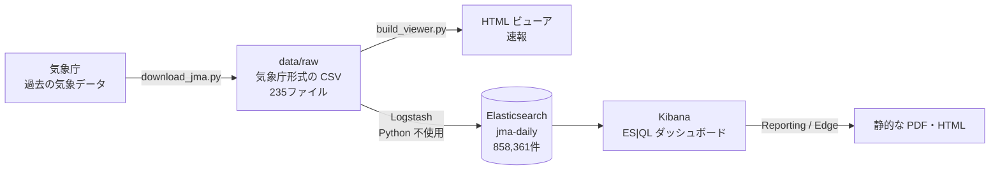
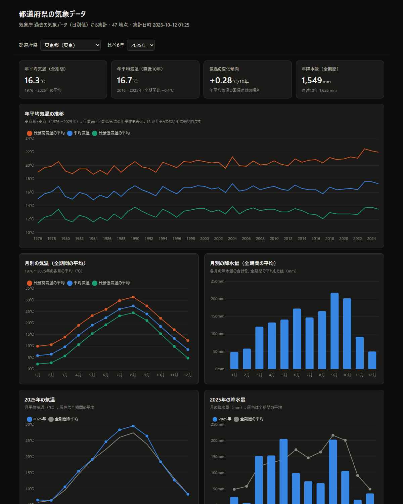
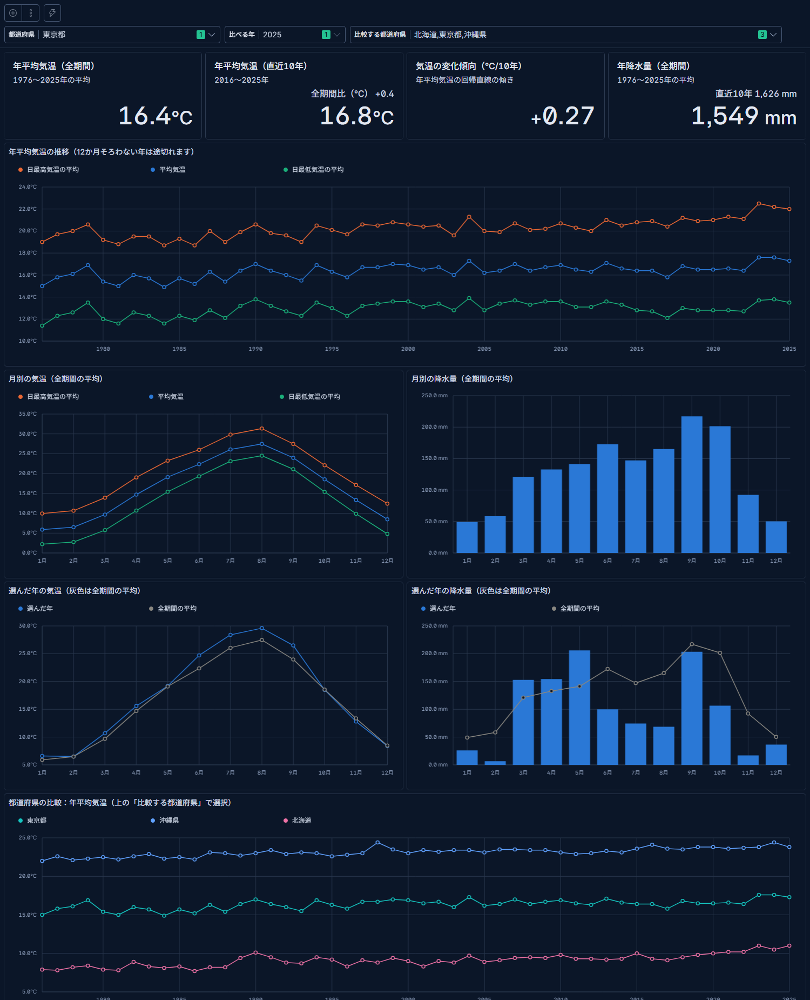

<!--
タイトル案: 気象庁の50年分の気温データを47都道府県分集めて、HTMLとKibana（ES|QL）で可視化するまで ― データ分析のプロセスに沿って
タグ案: Elasticsearch, Kibana, Logstash, ESQL, 気象庁
画像（images/ 以下）は Qiita にアップロードし、URL を差し替えてください。
-->

# はじめに

気象庁が公開している「過去の気象データ」を、**47都道府県の気象台について 1976〜2025 年の 50 年分**集め、手元の PC で見られるようにしました。

最初はすぐに見たかったので **HTML 1 ファイルのビューア**を作り、そのあと本番として **Elasticsearch + Kibana（ELK）** に取り込んでダッシュボードにしています。

この記事では、その作業を次の**データ分析のプロセス**に沿って整理します。

1. 目的を決める
2. データを集める
3. データを理解する（CSV のクセ・品質情報）
4. 前処理のルールを決める
5. まず速報で見る（HTML ビューア）
6. 分析基盤を作る（WSL2 + Docker で ELK）
7. 取り込む（Logstash だけで生 CSV を処理）
8. 検証する
9. 本番の可視化（Kibana / ES|QL ダッシュボード）
10. 共有する（静的な PDF / HTML）
11. 結果を読む

先に結果を一つだけ書くと、**47 地点すべてで年平均気温が上がっており、上昇ペースは 10 年あたり +0.27〜+0.53℃（平均 +0.41℃）**でした。

:::note info
作業は AI コーディングアシスタント（Claude Code）と対話しながら進めました。
:::

# 全体像



## 環境

| 項目 | 内容 |
|---|---|
| OS | Windows 11 |
| コンテナ | WSL2（Ubuntu 24.04）上の Docker Engine 27.3（**Docker Desktop は不使用**） |
| Elastic Stack | Elasticsearch / Kibana / Logstash 9.5.5（Basic ライセンス） |
| Python | 3.14（データ収集と HTML ビューアのみ。ELK 側では使わない） |
| その他 | Chart.js 4.4.1、Microsoft Edge（静的書き出しに使用） |

# 1. 目的を決める

- 気象庁のデータを**都道府県別**にダウンロードし、**ローカル PC で見たい**
- 最終的には **Kibana** で見たい。ただし、まずは**すぐに**見たい

そこで「速報は HTML、本番は Kibana」の二段構えにしました。見る指標は次の 4 つに絞っています。

- 日平均気温・日最高気温・日最低気温
- 日降水量

# 2. データを集める

## 対象

| 項目 | 内容 |
|---|---|
| 地点 | 各都道府県の気象台など 47 地点（札幌、青森、…、東京、…、那覇） |
| 種類 | 日別値 |
| 期間 | 1976〜2025 年（50 年） |
| 項目 | 平均気温・最高気温・最低気温・降水量の日合計 |

## ダウンロードの仕組み

「過去の気象データ・ダウンロード」の画面は、裏で次の POST を順番に送っています。これをスクリプトで再現しました。

1. `top/station`（`pd=00`）→ 地域の一覧
2. `top/station`（`pd=<地域ID>`）→ 各地域の地点一覧（例：東京 = `s47662`）
3. `show/table`（条件一式）→ CSV

```python:download_jma.py（抜粋）
data = {
    "stationNumList": json.dumps([stid]),
    "aggrgPeriod": "1",                                   # 日別値
    "elementNumList": json.dumps([[c, ""] for c in element_codes]),  # 201,202,203,101
    "interAnnualType": "1",                               # 連続した期間
    "ymdList": json.dumps([str(y1), str(y2), "1", "12", "1", "31"]),
    "rmkFlag": "1",          # 利用上注意が必要なデータも格納
    "disconnectFlag": "1",   # 観測環境の変化にかかわらず全期間を格納
    "fukenFlag": "1",        # 都道府県名を格納
    "csvFlag": "1",          # すべて数値で格納
    # …
}
r = session.post(BASE + "show/table", data=data)
```

## サーバーへの配慮

- リクエストは**直列で 2 秒間隔**
- 1 回の量に上限があるので、**10 年ずつ**に分けて取得（上限に当たったら期間を半分にして取り直す）
- **取得済みのファイルはスキップ**するので、止まっても再実行すれば続きから取れる

結果は **235 ファイル（47 地点 × 5 期間）、858,361 行**でした。

# 3. データを理解する

## CSV のクセ

気象庁の CSV は、そのままでは表計算や Elasticsearch に入れにくい形をしています。

```csv:jma_北海道_札幌_1986-1995.csv（先頭）
ダウンロードした時刻：2026/10/12 00:52:41

,石狩,石狩,石狩,…
,札幌,札幌,札幌,…
年月日,平均気温(℃),平均気温(℃),平均気温(℃),最高気温(℃),…,降水量の合計(mm),降水量の合計(mm),…
,,,,,,,,,,,,,
,,品質情報,均質番号,,品質情報,均質番号,,品質情報,均質番号,,現象なし情報,品質情報,均質番号
1986/1/1,-4.5,8,1,0.0,8,1,-9.5,8,1,2.5,0,8,1
```

| クセ | 内容 |
|---|---|
| 見出しが 6 行 | 時刻、空行、地域、地点、項目名、空行、サブ見出し |
| 同じ列名が何度も出る | `平均気温(℃)` が 3 回（値・品質情報・均質番号）。4 行目と 6 行目を組み合わせないと区別できない |
| 地点名が見出しにしかない | データ行には「札幌」が書かれていない |
| 降水量だけ列の並びが違う | 値・**現象なし情報**・品質情報・均質番号の 4 列 |
| 日付がゼロ埋めされていない | `1986/1/1` |
| 文字コード | 気象庁からは Shift_JIS で届く（ダウンロード時に UTF-8 に変換して保存） |

## 品質情報・均質番号・現象なし情報

| 情報 | 意味 |
|---|---|
| 品質情報 | 8 = 正常値、5 = 準正常値、4 = 資料不足値、2 = 疑問値、1 = 欠測 |
| 均質番号 | 観測場所の移転などで、データの性質が変わるたびに番号が増える |
| 現象なし情報 | 1 = 現象なし（その日に雨が降らなかった） |

全データを数えると、品質情報が 5 未満の値は**平均気温で 93 件、降水量で 205 件**ありました。ごくわずかですが、そのまま平均すると年の値が歪むので除外します。

:::note warn
**均質番号はダウンロードした期間の中で数え直されます**。10 年ずつに分けて取得すると、期間ごとに 1 から始まります。たとえば東京は 2006〜2015 年のファイルで **2014 年 12 月 2 日から均質番号が 2** に変わっています（観測地点が北の丸公園へ移転した日）。均質性を厳密に扱いたい場合は注意が必要です。
:::

# 4. 前処理のルールを決める

HTML でも Kibana でも同じ値になるよう、ルールを先に決めました。

| ルール | 内容 |
|---|---|
| 品質 | 品質情報が **5 以上**の値だけを使う |
| 月の値 | その月の日数の **8 割以上**の値がそろった月だけ出す（足りない月は空欄） |
| 年の値 | **12 か月そろった年**だけ出す。気温は「月平均の平均」、降水量は「月合計の合計」 |
| 直近 10 年 | 2016〜2025 年 |
| 変化傾向 | 年平均気温の**回帰直線の傾き**（℃/10 年） |

# 5. まず速報で見る（HTML ビューア）

`build_viewer.py`（標準ライブラリのみ）で日別値を月別・年別に集計し、結果の JSON を HTML に埋め込みました。`file://` で開いても `fetch` の制限に掛からないよう、データは HTML の中に直接入れています。グラフは Chart.js です。



- 都道府県と年を選ぶと、年平均気温の推移・月別の気候・選んだ年と平年の比較・一覧表が切り替わる
- 約 86 万行の日別値を月別に縮めたので、47 地点分でも HTML は約 640 KB

## 検証

札幌の 2024 年について、**生の CSV から直接計算した値**とビューアの値を突き合わせ、月平均気温 12 か月・年平均気温 10.5℃・年降水量 1,120.0 mm がすべて一致することを確認しました。

:::note warn
**ハマりどころ**：テンプレートの HTML コメントにも置換用の文字列（`/*__DATA__*/null`）を書いてしまい、データがコメントの中に埋め込まれて画面が真っ白になりました。「生成物から値を取り出して検算する」テストで気づけました。
:::

# 6. 分析基盤を作る（WSL2 + Docker Engine で ELK）

Docker Desktop は使わず、WSL2 の Ubuntu に入れた Docker Engine で動かしています。

```yaml:elk/docker-compose.yml（抜粋）
services:
  elasticsearch:
    image: docker.elastic.co/elasticsearch/elasticsearch:${ELASTIC_VERSION}
    restart: unless-stopped
    environment:
      - discovery.type=single-node
      - xpack.security.enabled=false      # ローカル検証用
      - ES_JAVA_OPTS=-Xms2g -Xmx2g
    ports:
      - "127.0.0.1:9200:9200"             # この PC からだけ接続できる
  kibana:
    image: docker.elastic.co/kibana/kibana:${ELASTIC_VERSION}
    restart: unless-stopped
    environment:
      - ELASTICSEARCH_HOSTS=http://elasticsearch:9200
      - I18N_LOCALE=ja-JP
    command: ["/usr/local/bin/kibana-docker",
              "--server.oas.enabled=true",
              "--xpack.security.showInsecureClusterWarning=false"]
  logstash:
    image: docker.elastic.co/logstash/logstash:${ELASTIC_VERSION}
    restart: unless-stopped
    volumes:
      - ./logstash/pipeline:/usr/share/logstash/pipeline:ro
      - ./logstash/templates:/usr/share/logstash/templates:ro
      - ../data/raw:/data/raw:ro          # Windows 側の CSV を読み取り専用で見せる
```

Windows の `C:\…\test_jma\data\raw` は、WSL からは `/mnt/c/…/test_jma/data/raw` に見え、さらにコンテナの中では `/data/raw` に見えます。

:::note warn
**ハマりどころ：WSL ごとコンテナが止まる**
WSL のターミナルを閉じてしばらくすると、Ubuntu が「使われていない」と判断して止まり、ELK も一緒に止まります。`restart: unless-stopped` を付けておけば、WSL が起動したときに ELK も自動で立ち上がります。
:::

# 7. 取り込む（Logstash だけで生 CSV を処理）

最初は Python で整形した CSV を取り込みましたが、「**Python を使わない前提**」に切り替え、気象庁形式の CSV を Logstash だけで処理するようにしました。

```ruby:elk/logstash/pipeline/jma.conf（抜粋）
input {
  file {
    path => "/data/raw/jma_*.csv"
    mode => "read"
    file_completed_action => "log"   # 既定は "delete"（読み終えた CSV が消える！）
    sincedb_path => "/dev/null"
    codec => plain { charset => "UTF-8" }  # 気象庁から落としたままなら "Windows-31J"
  }
}
filter {
  # 見出しの 6 行を捨てる（日付で始まる行だけ残す）
  if [message] !~ /^\d{4}\/\d{1,2}\/\d{1,2},/ { drop {} }

  # 列名は見出しから取れないので、列の順番どおりに書く
  csv {
    columns => ["date",
      "temp_avg", "temp_avg_quality", "temp_avg_homogeneity",
      "temp_max", "temp_max_quality", "temp_max_homogeneity",
      "temp_min", "temp_min_quality", "temp_min_homogeneity",
      "precip_total", "precip_total_nophenomenon", "precip_total_quality", "precip_total_homogeneity"]
    skip_empty_columns => true
    convert => { "temp_avg" => "float"  "temp_avg_quality" => "integer"  …  }
  }

  # 地点名は見出しにしかないので、ファイル名から取る
  grok { match => { "[log][file][path]" =>
    "jma_(?<prefecture>[^_/]+)_(?<station>[^_/]+)_\d+-\d+\.csv$" } }

  # ゼロ埋めなしの日付を、日本時間の 0 時として読む
  date { match => ["date", "yyyy/M/d"] timezone => "Asia/Tokyo" }

  # 品質情報が 5 未満の値は使わない
  if [temp_avg_quality] and [temp_avg_quality] < 5 { mutate { remove_field => ["temp_avg"] } }
  # …（最高・最低・降水量も同様）
}
output {
  elasticsearch {
    index => "jma-daily"
    document_id => "%{station}-%{date}"   # 何度読み直しても重複しない
    template => "/usr/share/logstash/templates/jma-daily.json"
    # …
  }
}
```

| クセ | Logstash での対処 |
|---|---|
| 見出しが 6 行 | 日付で始まらない行を `drop` |
| 同じ列名が何度も出る | `csv` の `columns` に列の順番で名前を付ける |
| 地点名が見出しにしかない | `grok` で**ファイル名**から取る（1 ファイル 1 地点が前提） |
| 日付がゼロ埋めされていない | `date` に `yyyy/M/d` |
| 再実行で重複する | `document_id` を「地点 + 日付」にする |

インデックステンプレートで、`prefecture` と `station` は `keyword`、気温と降水量は `float`、`date` は `yyyy/M/d` 形式の `date` にしています。

:::note info
Logstash は 1 行ずつ処理するので、「見出し行の地点名を後続の行に引き継ぐ」ことは苦手です。**1 ファイル 1 地点**でダウンロードし、ファイル名に地点を入れておくのがコツです。
:::

# 8. 検証する

| 確認したこと | 結果 |
|---|---|
| 件数 | **858,361 件**（CSV のデータ行数と一致） |
| 都道府県数・地点数 | 47・47 |
| ファイル名から地点を取れなかった行 | 0 件 |
| 品質による除外 | 平均気温 93 件・降水量 205 件（事前に数えた件数と一致） |
| 札幌 2024 年の年降水量 | 1,120.0 mm（HTML ビューアと一致） |

:::note warn
**ハマりどころ：Discover の件数が 47 件少ない**
時間の範囲を「1976/1/1 **9:00**〜」で開いていたため、1976 年 1 月 1 日（日本時間 0 時）の 47 地点 × 1 日分が範囲の外に出ていました。データは日本時間の 0 時で入っているので、時間の範囲に注意します。
:::

# 9. 本番の可視化（Kibana / ES|QL ダッシュボード）

## なぜ ES|QL か

Lens の通常の集計では、「日別 → 月平均 → 年平均」という**二段階の集計**や、**回帰直線の傾き**が素直に書けません。ES|QL なら `STATS` を重ねられるので、HTML ビューアと同じルールでそのまま計算できます。

```sql:年平均気温（HTML ビューアと同じルール）
FROM jma-daily
| WHERE prefecture == ?pref
| STATS t = AVG(temp_avg), nt = COUNT(temp_avg), days = COUNT(*) BY year, month
| EVAL t = CASE(nt >= days * 0.8, ROUND(t, 1))          // 8 割以上そろった月だけ
| STATS t = AVG(t), ct = COUNT(t) BY year
| EVAL t = CASE(ct == 12, ROUND(t, 1))                  // 12 か月そろった年だけ
| SORT year
```

```sql:変化傾向（回帰直線の傾き、℃/10年）
…（上の年平均気温の続き）
| WHERE t IS NOT NULL
| EVAL x = TO_DOUBLE(year - 2000)
| STATS n = COUNT(*), sx = SUM(x), sy = SUM(t), sxy = SUM(x * t), sxx = SUM(x * x)
| EVAL trend = (n * sxy - sx * sy) / (n * sxx - sx * sx) * 10
```

## ES|QL コントロールで「選ぶ」を再現

ダッシュボード上部の選択欄を **ES|QL の変数**にしました。変数を使っているパネルだけが切り替わるので、「都道府県の選択は比較グラフに効かせない」といった制御が簡単です。

| 選択欄 | 変数 | 使い方 |
|---|---|---|
| 都道府県 | `?pref` | `WHERE prefecture == ?pref` |
| 比べる年 | `?year` | `STATS sel = AVG(t) WHERE year == TO_INTEGER(?year), base = AVG(t) BY month` |
| 比較する都道府県（複数） | `?prefs` | `WHERE MV_CONTAINS(?prefs, prefecture)` |

## ダッシュボードはコード（API）で作成

Kibana 9.5 の **Dashboards API**（`PUT /api/dashboards/{id}`）で、パネルとコントロールを JSON で定義して作りました。

```bash
curl -X PUT 'localhost:5601/api/dashboards/jma-weather' \
  -H 'kbn-xsrf: true' -H 'Content-Type: application/json' \
  -H 'Elastic-Api-Version: 2023-10-31' \
  --data-binary @jma-dashboard.json
```

```json:jma-dashboard.json（抜粋）
{
  "title": "都道府県の気象データ",
  "time_range": { "from": "1975-12-31T15:00:00.000Z", "to": "2025-12-31T15:00:00.000Z" },
  "pinned_panels": [
    { "type": "esql_control", "width": "medium",
      "config": { "title": "都道府県", "variable_name": "pref", "variable_type": "values",
                  "control_type": "VALUES_FROM_QUERY",
                  "esql_query": "FROM jma-daily | STATS BY prefecture | …",
                  "selected_options": ["東京都"], "single_select": true } }
  ],
  "panels": [
    { "type": "vis", "grid": { "x": 0, "y": 6, "w": 48, "h": 15 },
      "config": { "type": "xy", "title": "年平均気温の推移",
        "layers": [{ "type": "line",
          "data_source": { "type": "esql", "query": "FROM jma-daily | …" },
          "x": { "column": "year" },
          "y": [{ "column": "t", "label": "平均気温", "color": { "type": "static", "color": "#2a78d6" } }] }] } }
  ]
}
```



:::note info
**API の仕様の調べ方**：Kibana を `--server.oas.enabled=true` で起動すると、`GET /api/oas?pathStartsWith=/api/dashboards` で OpenAPI の仕様（JSON）が取れます。パネルの種類（`xy`、`metric`、`data_table` など）や ES|QL コントロールの書き方は、ここから確認しました。
:::

:::note warn
**ハマりどころ**
- 保存オブジェクトのインポート（`_import`）に新しい形式の Lens を渡すと、古い形式からの変換処理が走って 500 エラーになった
- 表のパネルの `type` は `datatable` ではなく `data_table`
- Docker の Kibana では `SERVER_OAS_ENABLED` 環境変数が効かず、起動オプション（`command`）で渡す必要があった
:::

# 10. 共有する（静的な PDF / HTML）

Kibana の「共有 → 埋め込み」で取れる iframe は、**裏で Kibana につないで表示しているだけ**です。Kibana が止まっていたり、別の PC で開いたりすると見られません。静的に残す方法は 2 つ試しました。

| 方法 | 特徴 |
|---|---|
| Kibana の「エクスポート → PDF レポート / PNG レポート」 | ボタン 1 つで作れる。手元の 9.5.5（Basic ライセンス）でも生成できた。作ったものは「スタック管理 → レポート」からダウンロードする |
| Edge のヘッドレスモードで撮影するスクリプト | PowerShell だけで、画像を埋め込んだ HTML 1 ファイルと PDF を作る。毎回同じ見た目で作り直せる |

```powershell:export_static.ps1（流れ）
# 1. Kibana のメニューを隠した表示（?embed=true）でダッシュボード全体を撮影
msedge --headless=new --window-size=1500,4200 --virtual-time-budget=60000 --screenshot=raw.png "<ダッシュボードのURL>?embed=true"
# 2. 下の余白を切り取り、3. Base64 で HTML に埋め込み、4. その HTML を PDF に
msedge --headless=new --no-pdf-header-footer --print-to-pdf=kibana_dashboard.pdf "file:///…/kibana_dashboard.html"
```

:::note warn
静的に撮るときは、表のパネルを全行が見える高さにしておかないと、表の中のスクロールで途中が切れます。
:::

# 11. 結果を読む

## 全 47 地点で気温が上昇

| | 値 |
|---|---|
| 変化傾向（℃/10 年） | 最小 +0.27、最大 +0.53、**平均 +0.41**（47 地点すべてプラス） |
| 直近 10 年と全期間の差 | +0.4〜+1.2℃（平均 +0.92℃） |
| 47 地点の平均（年平均気温） | 1976〜1985 年 **14.52℃** → 2016〜2025 年 **16.31℃**（+1.79℃） |
| 47 地点平均で暑かった年 | 2024 年（17.12℃）、2023 年（16.83℃）、2025 年（16.74℃） |

## 上昇ペースが大きい地点・小さい地点

| 順位 | 大きい地点 | ℃/10 年 | 小さい地点 | ℃/10 年 |
|---|---|---|---|---|
| 1 | 兵庫県（神戸） | +0.53 | 東京都（東京） | +0.27 |
| 2 | 千葉県（千葉） | +0.51 | 宮崎県（宮崎） | +0.28 |
| 3 | 栃木県（宇都宮） | +0.51 | 長崎県（長崎） | +0.30 |
| 4 | 埼玉県（熊谷） | +0.50 | 大阪府（大阪） | +0.30 |
| 5 | 茨城県（水戸） | +0.49 | 沖縄県（那覇） | +0.31 |

## 読むときの注意

- 東京の上昇ペースが最も小さいのは、**2014 年 12 月に観測地点が大手町から北の丸公園へ移転した**影響が考えられます（均質番号もこの日から変わっています）。今回は移転による段差を補正していません。
- 各都道府県の**気象台 1 地点**の値で、都道府県全体の平均ではありません。
- 都市化（ヒートアイランド）の影響と、地球規模の温暖化を分けてはいません。
- 計算の細かな違いで、HTML と Kibana の値が 0.01〜0.1 ずれることがあります（四捨五入の方式の違い）。

# ハマりどころまとめ

| 場面 | ハマりどころ | 対処 |
|---|---|---|
| 収集 | 1 回のダウンロード量に上限がある | 10 年ずつに分割。上限に当たったら期間を半分に |
| 理解 | 均質番号はダウンロード期間ごとに数え直される | 期間をまたいで比べない |
| 速報 | 置換用の文字列がコメントにもあった | 生成物から値を取り出して検算する |
| 基盤 | WSL が止まると ELK も止まる | `restart: unless-stopped` |
| 取り込み | `file` 入力の read モードは既定で CSV を**削除**する | `file_completed_action => "log"` |
| 取り込み | 地点名が見出しにしかない | 1 ファイル 1 地点にして、ファイル名から取る |
| 検証 | 時間の範囲のずれで件数が合わない | 日本時間の 0 時を含むように範囲を取る |
| 可視化 | 二段階の集計や回帰が Lens で書けない | ES\|QL で `STATS` を重ねる |
| 可視化 | ダッシュボード API の書き方がわからない | `--server.oas.enabled=true` で OpenAPI を見る |
| 共有 | 埋め込みは Kibana がないと見られない | PDF レポート、または Edge で撮影して静的化 |

# まとめ

- 速報（HTML）と本番（Kibana）を分けたことで、**すぐに見る**ことと**ちゃんとした基盤**を両立できた
- 前処理のルール（品質 5 以上、月 8 割、年 12 か月）を最初に決め、**HTML と Kibana で同じ値になるか**を検証の軸にした
- 気象庁の CSV はクセが強いが、「1 ファイル 1 地点」「ファイル名に地点を入れる」ようにしておけば、**Logstash だけで取り込める**
- Kibana 9.5 は **ES|QL コントロール**と **Dashboards API** で、ダッシュボードを「コード」として作れる

今後は、都道府県の塗り分け地図、毎年のデータの追加、降雪量・積雪などの項目の追加を試したいと思います。

# 出典

- 気象庁「過去の気象データ・ダウンロード」（日別値）をもとに作成・集計しました。
